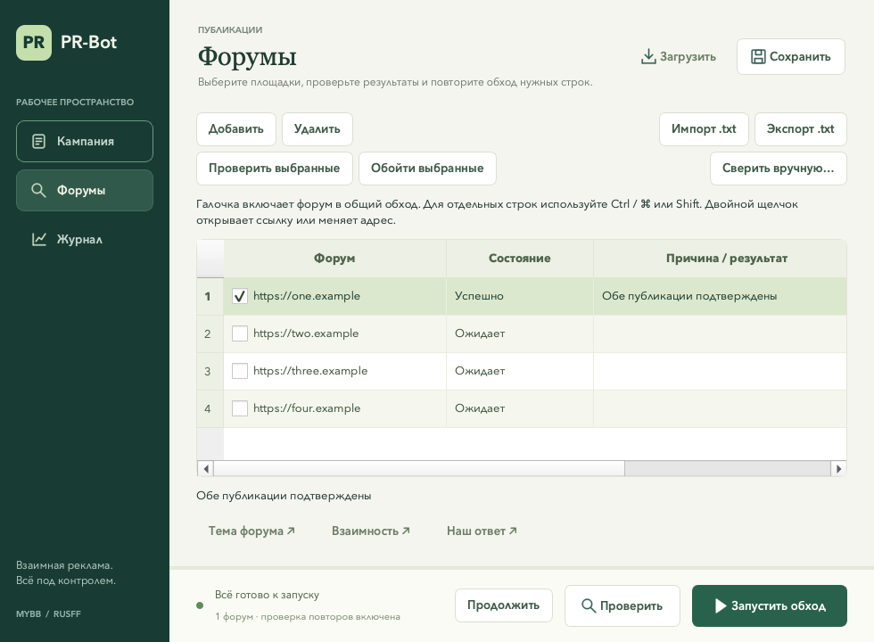

# C++ desktop port

Перенос сохраняет окно настроек, проверку последней страницы темы, вход через форумные скрипты, перенос рекламного кода и запись отчёта. UI написан на Qt Widgets. Автоматизация управляет Chrome через W3C WebDriver HTTP endpoints и запускает установленный ChromeDriver.

## Сборка Windows через GitHub Actions

Workflow `.github/workflows/windows-build.yml` собирает **Windows x64 Release** на `windows-2022` с MSVC 2022 и Qt 6.8.3. Запуск происходит при изменении `cpp/**`, иконки или workflow, а также по кнопке **Actions → Windows build → Run workflow**. Для ручного запуска файл workflow должен находиться в основной ветке; ветку сборки можно выбрать в меню.

После успешной сборки скачайте **Artifacts → PR-Bot-windows-x64** или воспользуйтесь ссылкой в итогах запуска. GitHub выдаёт ZIP с приложением, DLL Qt, платформенными и TLS-плагинами, установщиком Visual C++ Runtime, чистыми настройками и инструкцией. Артефакт хранится 30 дней. При первом скачивании требуется вход в GitHub.

На Windows полностью распакуйте архив в доступную для записи папку, установите `vc_redist.x64.exe` и запустите `prbot.exe`. Для приложения не нужны Python, Conda и установленный Qt. Нужен Google Chrome. `settings.json`, `forums.txt` и `log.txt` находятся рядом с exe; обновлятор сохраняет драйвер в `drivers/chromedriver.exe`. Перед обновлением приложения сохраните свои настройки, список и драйвер.

Сценарий `cpp/build_windows.ps1` собирает приложение и готовит каталог `cpp/dist/PR-Bot-windows-x64`. Упаковка берёт настройки из `cpp/packaging/windows`, а не из рабочего `settings.json`. В шаблоне нет аккаунта, объявления и адресов форумов. Компиляция использует `/utf-8`, чтобы русские строки не зависели от кодовой страницы Windows. Перед упаковкой workflow запускает `cpp/test_windows.ps1`: модульные проверки, интерфейс offscreen и браузерные сценарии на локальном HTTP-сервере. Скрипт подбирает официальный ChromeDriver к установленному на runner Chrome. При падении теста ZIP не создаётся; JUnit и `LastTest.log` доступны в артефакте **Windows-test-results** (14 дней). Сам `build_windows.ps1` выполняет только сборку и упаковку.

Повторить сборку локально можно на Windows с Visual Studio 2022 C++ Build Tools, CMake, PowerShell 7 и Qt MSVC 2022 x64:

```powershell
./cpp/test_windows.ps1 -QtRoot C:/Qt/6.8.3/msvc2022_64
./cpp/build_windows.ps1 -QtRoot C:/Qt/6.8.3/msvc2022_64
```

Сценарий использует `windeployqt` из выбранного Qt, добавляет нативный Schannel TLS-плагин и скачивает официальный Microsoft Visual C++ Redistributable с проверкой подписи. Пакет создаётся только после успешной сборки и наличия всех обязательных файлов. Созданные каталоги сборки и пакета исключены из Git.

## Local build environment

The project keeps its Conda environment in `cpp/.env`, its package cache in `cpp/.conda`, and build output in `cpp/build`. Install Conda once, then run from the repository root:

```bash
./cpp/build.sh
```

The environment definition in `cpp/environment.yml` installs CMake, Ninja, and Qt 6. The system C++ compiler is supplied by Xcode Command Line Tools on macOS.

To launch the app from the repository root:

```bash
conda run --prefix cpp/.env cpp/build/prbot
```

Chrome and a matching ChromeDriver executable are needed only for browser automation. Install the driver matching the installed Chrome into the local environment with:

```bash
./cpp/setup_chromedriver.sh
```

The script uses Google's Chrome for Testing version metadata and selects the current machine architecture. The application also offers driver checks and installation in **Параметры входа и браузера** (see below). Driver lookup prioritizes the local environment, then `PATH`; an explicitly selected executable takes precedence.

## Build and run

On macOS/Linux the application reads `settings.json` and writes `log.txt` in its current working directory. On Windows it uses the executable's directory. The bundled `driver/chromedriver.exe` in the source repository is a legacy binary and is not used automatically.

## Интерфейс

Окно разделено на три экрана: **Кампания** для подготовки объявления, **Форумы** для списка площадок и **Журнал** для наблюдения за проходом. Статус, запуск и остановка закреплены в нижней панели и доступны при прокрутке. При запуске открывается журнал; настройки на время прохода блокируются, поиск и фильтры журнала продолжают работать.

**Проверить** запускает тот же вход через сообщения PR-аккаунта, поиск актуальной темы и проверку рекламного кода, повторов, аккаунта и формы с кнопкой отправки. Исполнение заканчивается до вызова публикации. Собственное объявление для такой проверки не обязательно. Режим отмечается в окне и отчёте; счётчик «Готовы» показывает форумы, прошедшие проверку. Отправку рекламных сообщений начинает отдельная кнопка **Запустить обход**. Партнёрка по-прежнему пропускается только на текущий проход; новый запуск заново читает сообщения аккаунта.

На экране кампании можно перетащить файл со списком форумов в блок «Куда публикуем». Показываются короткое имя файла и число адресов; пустые строки и комментарии `#` не учитываются. Запуск становится доступен после заполнения обязательных параметров. На узком окне редактор и площадки располагаются друг под другом.

Параметры аккаунта и ChromeDriver свёрнуты в дополнительный блок. Поля логина/пароля появляются только при выборе специального аккаунта. У пароля есть кнопка показа; загрузка настроек очищает пароль и возвращает маскировку. Автовыбор драйвера сначала проверяет локальный `cpp/.env/bin/chromedriver`, затем `PATH`.

В журнале есть счётчики обработанных, успешных, пропущенных и ошибочных форумов, текущий этап, поиск и фильтр уровней. Кнопка копирования берёт показанные события с исходными временными отметками. Автопрокрутка не мешает чтению старых строк. В окне хранится до 5000 последних событий; полный журнал остаётся в `log.txt`.

Горячие клавиши: **⌘S / Ctrl+S** — сохранить настройки, **⌘O / Ctrl+O** — выбрать список форумов, **⌘Enter / Ctrl+Enter** — запустить готовую кампанию, **⌘L / Ctrl+L** — открыть поиск в журнале.


## Проверка ссылок на возможную партнёрку

Перед началом новой пары бот анализирует внешние ссылки в сообщениях открытой страницы темы. Если ссылки есть хотя бы в **трёх разных сообщениях** и все они ведут только на одну площадку, тема считается возможной партнёркой. Целевой форум пропускается до следующего обычного прохода; при таком результате в своей исходной теме обход останавливается до публикаций. Проверка работает и в режиме **Проверить**, независимо от настройки проверки повторов. На целевом форуме анализируется страница после возможного перехода на последнюю страницу. Восстановление уже начатой пары продолжает использовать сохранённые темы и доказательства публикаций.

Одна площадка считается один раз на сообщение, даже если её объявление содержит несколько ссылок. Исключаются первый пост с блоком шаблона, цитаты, подписи, блоки кода, адреса файлов изображений и других медиа, а также ссылки обратно на сам анализируемый форум (например, «ваша реклама»). Читаются ссылки `a[href]` в теле сообщения; адреса картинок `img[src]` в подсчёт не входят. HTTP/HTTPS и `www` объединяются, разные поддомены считаются разными площадками. Для стандартных PHP-страниц сохраняется каталог форума; для остальных ссылок используется полный домен и порт. Неизвестные внешние сайты тоже учитываются как отдельные площадки, без дополнительных сетевых запросов.

В журнал записываются адрес страницы, число просмотренных сообщений, число сообщений с внешними ссылками, количество площадок и частота их появления (первые 20 площадок). Повторение одной площадки среди нескольких разных не блокирует публикацию. Это дополнительный признак: короткая страница или партнёрка с несколькими внешними сайтами могут пройти проверку, а однообразная страница обычной рекламной темы — попасть под временный пропуск.

## Защита от рекламы на собственном форуме

Защита включена всегда: она действует при обычном и выборочном запуске, проверке без публикаций и продолжении, независимо от проверки повторов, лимита и случайного порядка. Собственный адрес из списка пропускается до открытия целевого форума. В журнале, деталях строки и итоговом отчёте появляется причина **Собственный форум — пропущен**; такой пропуск не расходует лимит успешных пар и не создаёт снимок ошибки.

Сравниваются адрес из настроек исходной темы и известные фактические адреса исходного форума, полученные при переходах в исходной вкладке и подтверждении публикаций. Учитываются HTTP/HTTPS, `www`, регистр/IDN домена и стандартные порты; каталог форума проверяется по границе пути. Например, `/forum2` не считается `/forum`, а `/forum/viewtopic.php` относится к `/forum`. Неизвестный дополнительный домен того же форума, который не появился в этих переходах, автоматически определить нельзя.

Повторные проверки выполняются после открытия целевого форума, выбора темы и перехода по страницам, до первой публикации взаимности и перед ответной отправкой. Проверяется также адрес формы ответа: она не должна отправлять сообщение на собственный форум. Непосредственно перед кликом страница и адрес формы сравниваются с проверенным снимком одной браузерной командой; при изменении отправка не начинается. Адрес формы с возможными служебными токенами используется только в памяти и не добавляется к доказательствам в `progress.json`.

Если собственный форум обнаружен в сохранённой частичной паре или уже после подтверждения взаимности, обход останавливается с требованием ручной сверки. Стадия отправки, ссылки и доказательства сохраняются; такая строка не превращается в завершённый пропуск. Размещение чужой рекламы в своей исходной теме остаётся штатной первой частью пары.

## Лимит рекламы за запуск

В **Кампания → Куда публикуем → Лимит реклам за запуск** укажите максимальное число успешных размещений, например **10**, или оставьте **Без ограничения** (значение `0`). Одна реклама здесь означает одну подтверждённую пару: чужой шаблон размещён в вашей теме, ваше объявление с взаимной ссылкой — на целевом форуме. Пропуски, уже найденная реклама, ошибки и незавершённая пара лимит не расходуют.

После достижения лимита бот сохраняет результат и завершает проход. Форумы, до которых он не дошёл, остаются в `progress.json` для **Продолжить**. Каждое продолжение получает новый лимит на этот запуск; число можно изменить перед продолжением. Восстановленная и подтверждённая пара тоже считается успешной в текущем запуске. Проверка лимита выполняется только после завершения всей пары публикаций.

Лимит действует для обычного и выборочного обхода; **Проверить** и **Проверить выбранные** проверяют весь соответствующий список без отправки сообщений. Настройка сохраняется в `settings.json` как `publication_limit`, при отсутствии этого ключа сохраняется прежнее поведение без ограничения. В журнале и отчёте указаны лимит, число размещений и оставшиеся форумы. Если список закончится или возникнет критическая ошибка, проход может закончиться до достижения заданного числа.

## Случайный порядок форумов

Включите **Кампания → Куда публикуем → Случайный порядок**, чтобы перемешивать адреса перед новым проходом. Каждый форум попадает в очередь один раз после удаления дублей; лимит по-прежнему считается по успешно завершённым парам. Обычный обход перемешивает включённые форумы, **Обойти выбранные** — выбранные строки. Порядок строк в самой таблице не меняется.

Полученная очередь сохраняется в порядке записей `entries` файла `progress.json` до открытия браузера. **Продолжить** отфильтровывает завершённые и отключённые строки, сохраняя относительный порядок оставшихся. Настройка случайного порядка при продолжении не перемешивает очередь; она действует на следующий новый проход. Незавершённые пары всегда сверяются и завершаются первыми. При новом обычном запуске создаётся новая очередь, сохраняя доказательства частичных отправок и результаты невыбранных строк.

**Проверить** и **Проверить выбранные** также используют случайный порядок при включённой настройке, но не меняют прогресс публикаций. В журнале и итоговом отчёте указан способ выбора порядка, а этап каждого форума показывает его позицию в очереди. Настройка хранится как `random_forum_order` в `settings.json`; в старых файлах и по умолчанию она выключена.

## Обновление ChromeDriver

После обновления Google Chrome раскройте **Параметры входа и браузера** и нажмите **Проверить обновления**. Приложение прочитает версии браузера и выбранного драйвера, покажет их в окне и найдёт подходящий выпуск в официальном каталоге Google. Проверка выполняется по кнопке; при обычном открытии окна сеть и загрузка драйвера не используются.

Если найдено обновление, появится кнопка **Установить**. Она скачивает только ChromeDriver для ОС и архитектуры приложения: в `cpp/.env/bin/chromedriver` на macOS/Linux или в `drivers/chromedriver.exe` рядом с программой на Windows. После установки локальная копия выбирается для текущей кампании. Если ранее был указан другой путь, нажмите **Сохранить**, чтобы сохранить новый выбор.

Во время проверки и установки окно остаётся доступным, отображаются этап и процент загрузки, есть кнопка **Отмена**. Запуск обхода, выбор драйвера и загрузка настроек временно блокируются. Во время прохода обновление недоступно. Обнаруженное несовпадение сборок Chrome и ChromeDriver блокирует запуск до исправления.

Архив и исполняемый файл сначала проверяются во временном каталоге; новый файл заменяет старый атомарно через `QSaveFile`. При отмене, сетевой ошибке или ошибке проверки старый драйвер остаётся на месте. Перед установкой и после загрузки повторно проверяется версия Chrome, чтобы учесть его автообновление. Для распаковки используется системный `unzip` (macOS/Linux) или `tar.exe` (Windows).

Подбор следует [рекомендациям ChromeDriver](https://developer.chrome.com/docs/chromedriver/downloads/version-selection): сначала по `MAJOR.MINOR.BUILD`, затем по milestone, если сборка ещё не добавлена в каталог. Используются [официальные JSON endpoints Chrome for Testing](https://github.com/GoogleChromeLabs/chrome-for-testing#json-api-endpoints) с адресами архивов. Автоподбор рассчитан на Chrome 115 и новее.

## Журнал работы

Каждый запуск пишет отдельный журнал в `logs/` с датой, временем, режимом (`check` или `publish`) и уникальным суффиксом. `log.txt` содержит копию текущего прохода. Последний журнал прежней версии однократно переносится в историю перед первым перезаписыванием. Если каталог истории недоступен, подготовка останавливается до запуска браузера.

Кнопка **Журнал → История** открывает список запусков и просмотр выбранного журнала. Есть обновление списка, открытие полного файла и папки. Для больших файлов в окне показываются последние 2 МБ; файл на диске сохраняется целиком. Обновление приложения должно сохранять и папку `logs`.

События сразу записываются на диск и отображаются в окне: время с часовым поясом, уровень (`ИНФО`, `ВНИМАНИЕ`, `ОШИБКА`), этап, текущий форум и описание действия. Например:

```text
[2026-10-22T12:00:00.000+03:00] [ИНФО] [Открытие форума] [https://forum.example/] Форум 1 из 3.
[2026-10-22T12:00:04.000+03:00] [ВНИМАНИЕ] [Проверка темы] [https://forum.example/] В последней теме PR-аккаунта отсутствует форма ответа; форум пропущен до следующего прохода.
```

## Диагностика ошибок

При ошибке бот сохраняет её время, адрес форума, адрес открытой страницы, этап, стадию публикации и снимок видимой области страницы. Версии программы, ревизия Git, Qt, Chrome, ChromeDriver, ОС и архитектура записываются для каждого запуска. Данные находятся в `diagnostics/<имя архивного журнала>/` рядом с `logs/`; контексты нескольких ошибок одного запуска не перезаписывают друг друга. Обычная остановка пользователем и обнаруженный повтор рекламы не создают снимки ошибок.

После завершения прохода нажмите **Журнал → Сохранить диагностику**. ZIP содержит `run.json` с версиями и ошибками, `journal.log` именно этого запуска, доступные PNG в `screenshots/` и краткую инструкцию. Если сохранённый PNG позже удалён или повреждён, экспорт включает остальные данные и `export-notes.txt` с причиной пропуска. В **Истории** такая же кнопка экспортирует выбранный запуск; данные остаются доступны после перезапуска приложения. Для журналов, созданных прежними версиями без диагностики, кнопка недоступна. Экспорт из открытой истории во время прохода сохраняет имеющиеся к этому моменту данные.

Перед снимком скрываются поля ввода; известный программе пароль маскируется в тексте страницы. Значения полей не изменяются, события форм не вызываются, временные маски затем снимаются. Настройки, `progress.json`, cookies, хранилище браузера и HTML страницы не включаются в ZIP. В текстовых данных скрываются известные секреты, встроенные в URL логин/пароль и параметры паролей/токенов. Остальное видимое содержимое форума остаётся на снимке.

Если ChromeDriver ещё не запущен, уже закрылся или не отвечает, описание ошибки сохраняется с причиной отсутствия снимка; недоступные версии отмечаются явно. Запросы диагностики имеют короткие отдельные тайм-ауты. Сбой снимка/записи диагностики не вызывает повторной отправки и не заменяет первоначальную ошибку. PNG и метаданные сохраняются атомарно; исходные журналы и снимки экспортом не изменяются.

ZIP создаётся самим приложением без внешнего архиватора, с PNG без повторного сжатия. Для очень больших журналов включаются последние 8 МБ, о чём будет отметка; предел отдельного PNG — 16 МБ, всего архива — 512 МБ. Папку `diagnostics` следует сохранять вместе с `logs` при обновлении приложения.

## Таблица форумов

В разделе **Форумы** можно добавить адрес, изменить его двойным щелчком, удалить строки или отключить их галочками. Импорт `.txt` заменяет таблицу; экспорт пишет только включённые адреса. Пустые строки и комментарии `#` пропускаются, HTTP/HTTPS и `www` одного форума не создают дубли. Некорректные адреса сохраняются видимыми, но отключаются до исправления. Адрес без схемы получает HTTPS.

Выделите строки через Ctrl/⌘ или Shift и нажмите **Проверить выбранные** либо **Обойти выбранные**. Явный выбор действует также для отключённых строк; обычный запуск обрабатывает только включённые. Таблица показывает состояние, причину, тему и ссылки на обе публикации; двойной щелчок по ссылке открывает её в браузере. Параметры строк сохраняются в `settings.json` кнопкой **Сохранить** и перед запуском; исходный текстовый файл автоматически не переписывается.



## Продолжение после сбоя

`progress.json` рядом с `log.txt` содержит очередь, снимок кампании, стадии отправки, исходные ID сообщений, авторов и ссылки. Запись атомарная и выполняется перед кликом и после подтверждения; если запись недоступна, следующая отправка не начинается. Блокировка `progress.json.lock` исключает одновременный проход в этой же папке. Проверка без публикаций не изменяет этот файл.

Кнопка **Продолжить** появляется при незавершённом проходе. Она восстанавливает параметры кампании и обрабатывает незавершённые включённые строки. Удалённые из таблицы незавершённые строки возвращаются при продолжении. Пароль потребуется ввести заново. Завершённые и временно пропущенные строки при продолжении не обходятся; обычный новый запуск заново проверяет актуальную тему аккаунта.

Если могла начаться отправка, бот сначала сверяет автора, новые ID и содержимое в сохранённых темах (до четырёх страниц, включая ссылки на последнюю). Найденные сообщения используются без дублирования. Если первая публикация подтверждена, а вторая ещё не отправлялась или была явно отклонена, продолжается только вторая часть. Закрытая исходная тема не мешает прочитать уже размещённую взаимность. Если неизвестный результат не удаётся найти, повтор блокируется.

Для ручного разрешения выделите строку и нажмите **Сверить вручную…**, предварительно открыв обе темы из таблицы. Можно подтвердить наличие обеих публикаций, отсутствие обеих или наличие только взаимности. Последний вариант разрешает отправку нашего ответа после повторной проверки первого сообщения. Пока есть незавершённая пара, новый проход с другим объявлением/исходной темой блокируется.

`progress.json` содержит **публичные рекламные тексты** для сверки, но не пароль аккаунта. Сохраняйте его вместе с `settings.json` и `logs` при обновлении программы; удаление файла лишает приложение сведений о незавершённых отправках. Отдельные копии программы в разных папках имеют независимый прогресс.

Журнал показывает версии Chrome и ChromeDriver, способ входа, найденную тему, наличие формы/кода/картинки, проверку повторов и ссылку на каждое подтверждённое сообщение. При ошибке остаётся виден последний этап. После частичной отправки сохраняется ссылка на первую публикацию; перед повтором нужно проверить обе темы.

В конце файла добавляются итоги: начало и завершение, длительность в секундах, обработанные и оставшиеся форумы, результат и причина по каждому адресу. Пароль, полный рекламный шаблон и встроенные в URL учётные данные скрываются. JSON команд WebDriver не журналируется.

Если файл нельзя открыть, подготовка завершается до запуска браузера. Если запись перестала работать во время прохода, в окне появляется сообщение; браузерный сценарий продолжается, чтобы сбой журнала не вызвал повторную отправку.

## Подтверждение и остановка

Статус «Успешно» устанавливается после появления обоих новых сообщений. Модуль `ForumPage` запоминает ID постов до отправки и проверяет новый ID, автора, ссылки/картинки рекламного шаблона либо текст для объявления без ссылок. В ответной рекламе дополнительно проверяется точная ссылка на первую публикацию. Если сайт сообщил об отказе или результат не удалось подтвердить за отведённое время, обход останавливается без автоматического повторного клика.

Проверка рассчитана на DOM MyBB/RusFF: `.post`, `.post-content`, ссылки на профиль автора и permalink сообщения. Изменённая разметка может дать неопределённый результат даже после фактической отправки; в таком случае нужно проверить тему вручную. Существующая проверка рекламной темы остаётся эвристикой, а поиск повторов — проверкой последней страницы.

Для повторов извлекаются настоящие адреса ссылок и картинок из сообщений, исключая блоки кода; для принадлежности шаблона — URL из тегов `[url]` и `[img]`. Сравниваются полный домен, нестандартный порт и каталог форума с границей пути. HTTP/HTTPS, стандартные порты и вариант `www` нормализуются; другие доменные алиасы учитываются только после фактического перехода браузера в тему на этом домене. Текстовое упоминание имени, чужой домен с похожим началом и адрес внутри query другого сайта не считаются ссылкой на форум.

Кнопка «Остановить» завершает подготовку между браузерными командами. Если первая отправка уже началась, бот завершает текущую пару публикаций и затем прекращает обход. Закрытие окна запрашивает такую же остановку и откладывается до завершения рабочего потока. Текущая команда ChromeDriver и ожидание подтверждения имеют ограниченное время, поэтому остановка не обязательно мгновенна.

При входе бот один раз открывает сообщения выбранного PR-аккаунта; переход в профиль и повторный обход поиска удалены. Вместо фиксированных пауз используются проверки готовности страницы с предельным сроком. ChromeDriver получает отдельный свободный локальный порт; типы его ошибок обрабатываются по кодам, а не по тексту сообщения.

## Safe verification

`prbot_core_tests` checks settings round-tripping and confirms that passwords are neither loaded from legacy JSON nor written to new settings. It does not open a browser or post to any forum. A real run starts only after the user presses **Запустить** and can publish messages to every valid forum in the selected list.

`prbot_log_tests` checks immediate journal persistence, secret filtering, matching UI/file events, and an early failure of `PrBot` on a missing forum list. It also runs without a browser or forum publications. Run the offline checks with `./cpp/.env/bin/ctest --test-dir cpp/build --output-on-failure` from the repository root.

`prbot_state_tests` проверяет идентичность адресов, нормализацию, таблицу, импорт/экспорт, сериализацию без пароля, блокировку конкурирующих проходов, частичные стадии, фильтр продолжения, ручное разрешение и отказ при повреждённом или недоступном файле прогресса.

`prbot_ui_tests` проверяет таблицу, отключение/выбор строк, готовность проверки без объявления, широкую и узкую компоновки, перетаскивание файла, готовность запуска, раскрытие аккаунта, маскировку пароля, фильтрацию и копирование журнала. Тест работает через Qt offscreen, не запускает обход и использует временные демонстрационные настройки. Снимки можно обновить командой `QT_QPA_PLATFORM=offscreen cpp/build/prbot_ui_tests docs/ui` из корня проекта.

`prbot_browser_tests` запускает установленный ChromeDriver и локальный сервер на `127.0.0.1`. Сценарии проверяют две публикации, задержанное появление DOM, второй PR-аккаунт, отказ сайта, частичный результат, партнёрку, старые сообщения, чужого автора, неполный текст, неверную взаимную ссылку и закрытие работающего окна. Дополнительные сценарии проверяют режим без публикаций, выборочный запуск, сохранение при отклонённом ответе, восстановление обеих стадий после потери подтверждения, закрытую исходную тему, запрет дублирования, ручную сверку и ошибку записи перед кликом. Тестовые сообщения существуют только в памяти локального сервера; реальные форумы не открываются.

Браузерные проверки выключены по умолчанию. Для их включения нужны установленные Chrome и совместимый драйвер:

```bash
./cpp/.env/bin/cmake -S cpp -B cpp/build -DPRBOT_BROWSER_TESTS=ON \
  -DPRBOT_TEST_CHROMEDRIVER="$PWD/cpp/.env/bin/chromedriver"
./cpp/.env/bin/cmake --build cpp/build --parallel 2
./cpp/.env/bin/ctest --test-dir cpp/build --output-on-failure
```

Вернуть только проверки без браузера можно параметром `-DPRBOT_BROWSER_TESTS=OFF` при конфигурации CMake.

When migrating `settings.json`, ordinary values and the account login are loaded, but any legacy password field is ignored. Enter the password in the UI each time it is needed; it stays in process memory and is not saved.

The original Python files remain in the repository as a behavior reference until the C++ port is verified against the user's forum setup.
