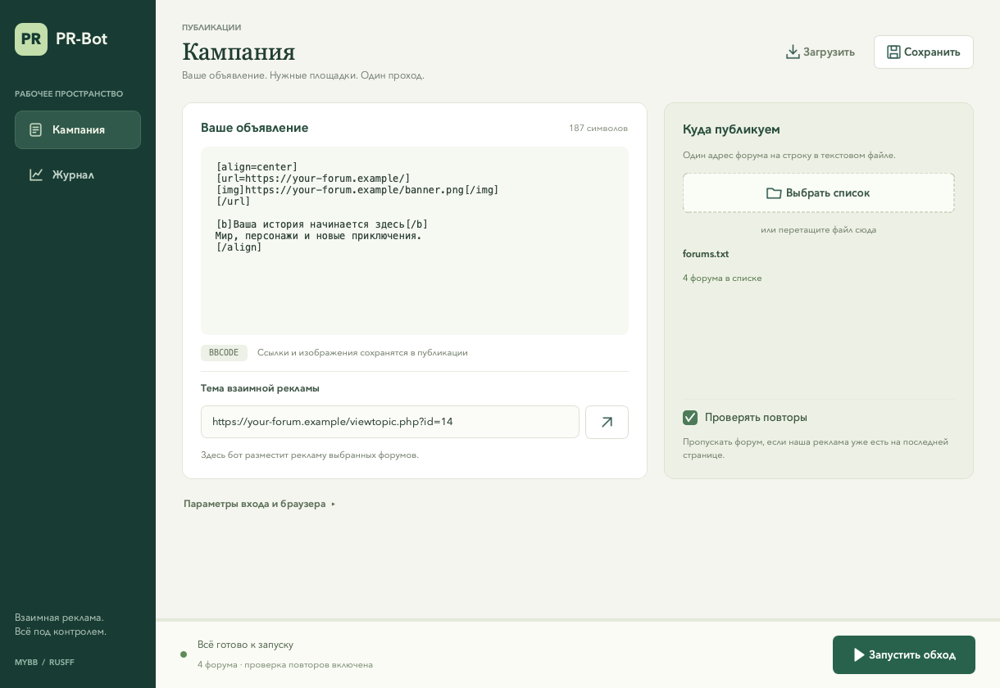

# C++ desktop port

Перенос сохраняет окно настроек, проверку последней страницы темы, вход через форумные скрипты, перенос рекламного кода и запись отчёта. UI написан на Qt Widgets. Автоматизация управляет Chrome через W3C WebDriver HTTP endpoints и запускает установленный ChromeDriver.

## Сборка Windows через GitHub Actions

Workflow `.github/workflows/windows-build.yml` собирает **Windows x64 Release** на `windows-2022` с MSVC 2022 и Qt 6.8.3. Запуск происходит при изменении `cpp/**`, иконки или workflow, а также по кнопке **Actions → Windows build → Run workflow**. Для ручного запуска файл workflow должен находиться в основной ветке; ветку сборки можно выбрать в меню.

После успешной сборки скачайте **Artifacts → PR-Bot-windows-x64** или воспользуйтесь ссылкой в итогах запуска. GitHub выдаёт ZIP с приложением, DLL Qt, платформенными и TLS-плагинами, установщиком Visual C++ Runtime, чистыми настройками и инструкцией. Артефакт хранится 30 дней. При первом скачивании требуется вход в GitHub.

На Windows полностью распакуйте архив в доступную для записи папку, установите `vc_redist.x64.exe` и запустите `prbot.exe`. Для приложения не нужны Python, Conda и установленный Qt. Нужен Google Chrome. `settings.json`, `forums.txt` и `log.txt` находятся рядом с exe; обновлятор сохраняет драйвер в `drivers/chromedriver.exe`. Перед обновлением приложения сохраните свои настройки, список и драйвер.

Сценарий `cpp/build_windows.ps1` собирает приложение и готовит каталог `cpp/dist/PR-Bot-windows-x64`. Упаковка берёт настройки из `cpp/packaging/windows`, а не из рабочего `settings.json`. В шаблоне нет аккаунта, объявления и адресов форумов. Компиляция использует `/utf-8`, чтобы русские строки не зависели от кодовой страницы Windows. Тесты и браузер при сборке пакета не запускаются.

Повторить сборку локально можно на Windows с Visual Studio 2022 C++ Build Tools, CMake, PowerShell 7 и Qt MSVC 2022 x64:

```powershell
./cpp/build_windows.ps1 -QtRoot C:/Qt/6.8.3/msvc2022_64
```

Сценарий использует `windeployqt` из выбранного Qt, добавляет нативный Schannel TLS-плагин и скачивает официальный Microsoft Visual C++ Redistributable с проверкой подписи. Пакет создаётся только после успешной сборки и наличия всех обязательных файлов. Созданные каталоги сборки и пакета исключены из Git.

## Local build environment

The project keeps its Conda environment in `cpp/.env`, its package cache in `cpp/.conda`, and build output in `cpp/build`. Install Conda once, then run from the repository root:

```bash
./cpp/build.sh
```

The environment definition in `cpp/environment.yml` installs CMake, Ninja, and Qt 6. The system C++ compiler is supplied by Xcode Command Line Tools on macOS.

To launch the app from the repository root:

```bash
conda run --prefix cpp/.env cpp/build/prbot
```

Chrome and a matching ChromeDriver executable are needed only for browser automation. Install the driver matching the installed Chrome into the local environment with:

```bash
./cpp/setup_chromedriver.sh
```

The script uses Google's Chrome for Testing version metadata and selects the current machine architecture. The application also offers driver checks and installation in **Параметры входа и браузера** (see below). Driver lookup prioritizes the local environment, then `PATH`; an explicitly selected executable takes precedence.

## Build and run

On macOS/Linux the application reads `settings.json` and writes `log.txt` in its current working directory. On Windows it uses the executable's directory. The bundled `driver/chromedriver.exe` in the source repository is a legacy binary and is not used automatically.

## Интерфейс

Окно разделено на два экрана: **Кампания** для подготовки объявления и **Журнал** для наблюдения за проходом. Статус, запуск и остановка закреплены в нижней панели и доступны при прокрутке. При запуске открывается журнал; настройки на время прохода блокируются, поиск и фильтры журнала продолжают работать.

На экране кампании можно перетащить файл со списком форумов в блок «Куда публикуем». Показываются короткое имя файла и число адресов; пустые строки и комментарии `#` не учитываются. Запуск становится доступен после заполнения обязательных параметров. На узком окне редактор и площадки располагаются друг под другом.

Параметры аккаунта и ChromeDriver свёрнуты в дополнительный блок. Поля логина/пароля появляются только при выборе специального аккаунта. У пароля есть кнопка показа; загрузка настроек очищает пароль и возвращает маскировку. Автовыбор драйвера сначала проверяет локальный `cpp/.env/bin/chromedriver`, затем `PATH`.

В журнале есть счётчики обработанных, успешных, пропущенных и ошибочных форумов, текущий этап, поиск и фильтр уровней. Кнопка копирования берёт показанные события с исходными временными отметками. Автопрокрутка не мешает чтению старых строк. В окне хранится до 5000 последних событий; полный журнал остаётся в `log.txt`.

Горячие клавиши: **⌘S / Ctrl+S** — сохранить настройки, **⌘O / Ctrl+O** — выбрать список форумов, **⌘Enter / Ctrl+Enter** — запустить готовую кампанию, **⌘L / Ctrl+L** — открыть поиск в журнале.



## Обновление ChromeDriver

После обновления Google Chrome раскройте **Параметры входа и браузера** и нажмите **Проверить обновления**. Приложение прочитает версии браузера и выбранного драйвера, покажет их в окне и найдёт подходящий выпуск в официальном каталоге Google. Проверка выполняется по кнопке; при обычном открытии окна сеть и загрузка драйвера не используются.

Если найдено обновление, появится кнопка **Установить**. Она скачивает только ChromeDriver для ОС и архитектуры приложения: в `cpp/.env/bin/chromedriver` на macOS/Linux или в `drivers/chromedriver.exe` рядом с программой на Windows. После установки локальная копия выбирается для текущей кампании. Если ранее был указан другой путь, нажмите **Сохранить**, чтобы сохранить новый выбор.

Во время проверки и установки окно остаётся доступным, отображаются этап и процент загрузки, есть кнопка **Отмена**. Запуск обхода, выбор драйвера и загрузка настроек временно блокируются. Во время прохода обновление недоступно. Обнаруженное несовпадение сборок Chrome и ChromeDriver блокирует запуск до исправления.

Архив и исполняемый файл сначала проверяются во временном каталоге; новый файл заменяет старый атомарно через `QSaveFile`. При отмене, сетевой ошибке или ошибке проверки старый драйвер остаётся на месте. Перед установкой и после загрузки повторно проверяется версия Chrome, чтобы учесть его автообновление. Для распаковки используется системный `unzip` (macOS/Linux) или `tar.exe` (Windows).

Подбор следует [рекомендациям ChromeDriver](https://developer.chrome.com/docs/chromedriver/downloads/version-selection): сначала по `MAJOR.MINOR.BUILD`, затем по milestone, если сборка ещё не добавлена в каталог. Используются [официальные JSON endpoints Chrome for Testing](https://github.com/GoogleChromeLabs/chrome-for-testing#json-api-endpoints) с адресами архивов. Автоподбор рассчитан на Chrome 115 и новее.

## Журнал работы

При каждом запуске `log.txt` заменяется новым журналом. События сразу записываются на диск и отображаются в окне: время с часовым поясом, уровень (`ИНФО`, `ВНИМАНИЕ`, `ОШИБКА`), этап, текущий форум и описание действия. Например:

```text
[2026-10-22T12:00:00.000+03:00] [ИНФО] [Открытие форума] [https://forum.example/] Форум 1 из 3.
[2026-10-22T12:00:04.000+03:00] [ВНИМАНИЕ] [Проверка темы] [https://forum.example/] В последней теме PR-аккаунта отсутствует форма ответа; форум пропущен до следующего прохода.
```

Журнал показывает версии Chrome и ChromeDriver, способ входа, найденную тему, наличие формы/кода/картинки, проверку повторов и ссылку на каждое подтверждённое сообщение. При ошибке остаётся виден последний этап. После частичной отправки сохраняется ссылка на первую публикацию; перед повтором нужно проверить обе темы.

В конце файла добавляются итоги: начало и завершение, длительность в секундах, обработанные и оставшиеся форумы, результат и причина по каждому адресу. Пароль, полный рекламный шаблон и встроенные в URL учётные данные скрываются. JSON команд WebDriver не журналируется.

Если файл нельзя открыть, подготовка завершается до запуска браузера. Если запись перестала работать во время прохода, в окне появляется сообщение; браузерный сценарий продолжается, чтобы сбой журнала не вызвал повторную отправку.

## Подтверждение и остановка

Статус «Успешно» устанавливается после появления обоих новых сообщений. Модуль `ForumPage` запоминает ID постов до отправки и проверяет новый ID, автора, ссылки/картинки рекламного шаблона либо текст для объявления без ссылок. В ответной рекламе дополнительно проверяется точная ссылка на первую публикацию. Если сайт сообщил об отказе или результат не удалось подтвердить за отведённое время, обход останавливается без автоматического повторного клика.

Проверка рассчитана на DOM MyBB/RusFF: `.post`, `.post-content`, ссылки на профиль автора и permalink сообщения. Изменённая разметка может дать неопределённый результат даже после фактической отправки; в таком случае нужно проверить тему вручную. Существующая проверка рекламной темы остаётся эвристикой, а поиск повторов — проверкой последней страницы.

Кнопка «Остановить» завершает подготовку между браузерными командами. Если первая отправка уже началась, бот завершает текущую пару публикаций и затем прекращает обход. Закрытие окна запрашивает такую же остановку и откладывается до завершения рабочего потока. Текущая команда ChromeDriver и ожидание подтверждения имеют ограниченное время, поэтому остановка не обязательно мгновенна.

При входе бот один раз открывает сообщения выбранного PR-аккаунта; переход в профиль и повторный обход поиска удалены. Вместо фиксированных пауз используются проверки готовности страницы с предельным сроком. ChromeDriver получает отдельный свободный локальный порт; типы его ошибок обрабатываются по кодам, а не по тексту сообщения.

## Safe verification

`prbot_core_tests` checks settings round-tripping and confirms that passwords are neither loaded from legacy JSON nor written to new settings. It does not open a browser or post to any forum. A real run starts only after the user presses **Запустить** and can publish messages to every valid forum in the selected list.

`prbot_log_tests` checks immediate journal persistence, secret filtering, matching UI/file events, and an early failure of `PrBot` on a missing forum list. It also runs without a browser or forum publications. Run the offline checks with `./cpp/.env/bin/ctest --test-dir cpp/build --output-on-failure` from the repository root.

`prbot_ui_tests` проверяет широкую и узкую компоновки, перетаскивание файла, готовность запуска, раскрытие аккаунта, маскировку пароля, фильтрацию и копирование журнала. Тест работает через Qt offscreen, не запускает обход и использует временные демонстрационные настройки. Снимки можно обновить командой `QT_QPA_PLATFORM=offscreen cpp/build/prbot_ui_tests docs/ui` из корня проекта.

`prbot_browser_tests` запускает установленный ChromeDriver и локальный сервер на `127.0.0.1`. Сценарии проверяют две публикации, задержанное появление DOM, второй PR-аккаунт, отказ сайта, частичный результат, партнёрку, старые сообщения, чужого автора, неполный текст, неверную взаимную ссылку и закрытие работающего окна. Тестовые сообщения существуют только в памяти локального сервера; реальные форумы не открываются.

Браузерные проверки выключены по умолчанию. Для их включения нужны установленные Chrome и совместимый драйвер:

```bash
./cpp/.env/bin/cmake -S cpp -B cpp/build -DPRBOT_BROWSER_TESTS=ON \
  -DPRBOT_TEST_CHROMEDRIVER="$PWD/cpp/.env/bin/chromedriver"
./cpp/.env/bin/cmake --build cpp/build --parallel 2
./cpp/.env/bin/ctest --test-dir cpp/build --output-on-failure
```

Вернуть только проверки без браузера можно параметром `-DPRBOT_BROWSER_TESTS=OFF` при конфигурации CMake.

When migrating `settings.json`, ordinary values and the account login are loaded, but any legacy password field is ignored. Enter the password in the UI each time it is needed; it stays in process memory and is not saved.

The original Python files remain in the repository as a behavior reference until the C++ port is verified against the user's forum setup.
